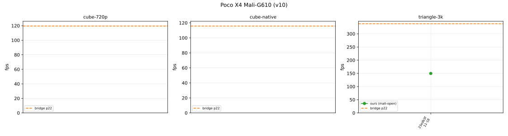
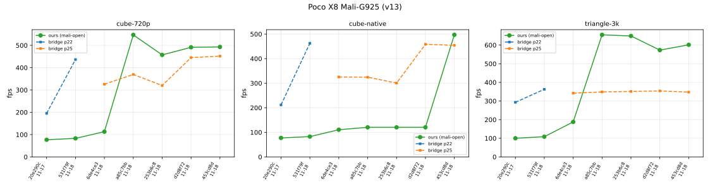

# mali-open

An open Vulkan driver for Arm Mali GPUs on Android phones, written from scratch in C11. It runs in userspace on top of the vendor's
`mali_kbase` kernel driver (`/dev/mali0`), so it needs no root and no kernel changes. It is a Vulkan ICD
(`libvulkan_mali.so`) for the Linux guest in which games run.

**Status: pre-release (0.1.0).** It draws, computes, presents and passes part of dEQP-VK. It is not conformant, and the limits are listed below.


The diagram is generated by `tools/progress.py` from the test sources, the dEQP sample results and `docs/progress.toml` (item list with evidence: `docs/progress.md`). CI checks it is current and refreshes it on main. CI runs on machines without a Mali GPU, so every phone result (dEQP, hardware passes) is committed from the maintainer's own devices; CI only proves the offline checks.

## GPUs

| GPU | Arch | kbase uAPI | State |
|---|---|---|---|
| Mali-G610 | Valhall v10 (CSF) | see `vk/DEVICE-poco-x4.md` | Bring-up on the Poco X4: dEQP sample and triangle benchmark run, no cube benchmark row yet (`vk/V10-BRINGUP.md`) |
| Mali-G615 | Valhall v11 (CSF) | 1.21 | Developed and verified on hardware |
| Mali-G925 | Arm 5th gen v13 (CSF) | 1.30 | Runs on hardware (draw, compute, dEQP sample). Fewer hours of testing |

Only CSF-based Mali (v10+) is in scope. Bifrost and Midgard JM GPUs are not supported. libkbase refuses uAPI versions it has not been checked against.

## Performance

How close mali-open gets to the Mali bridge (MediaDeck's, the target) per phone, measured in the DroidDeck arm64 guest. The cube benchmark is GPU-heavy, the triangle benchmark (3000 draws per frame) is CPU-heavy; PanVK (Mesa) is shown once it has been measured. Method: `bench/README.md`.

<!-- perf:begin -->

| Phone | GPU / arch | Benchmark | Ours first (build, date) | Ours latest (build, date) | Change | Bridge latest fps | Ours % of bridge | PanVK | GPU ms ours / bridge |
|---|---|---|---|---|---|---|---|---|---|
| cmf | CMF Mali-G615 (v11) | cube-720p | 46.0 (e2cd68cd2, 2026-11-18) | 62.4 (46631edd8, 2026-11-19) | +35% | 70.7 (p25) | 88% | not measured | 13.11 / 11.30 |
| cmf | CMF Mali-G615 (v11) | cube-native | 45.9 (e2cd68cd2, 2026-11-18) | 62.1 (46631edd8, 2026-11-19) | +35% | 70.5 (p25) | 88% | not measured | 13.19 / 11.29 |
| cmf | CMF Mali-G615 (v11) | triangle-10k | 145.3 (46631edd8, 2026-11-19) | 145.3 (46631edd8, 2026-11-19) | n/a | 82.7 (p25) | 176% | not measured | 2.96 / 7.30 |
| cmf | CMF Mali-G615 (v11) | triangle-20k | 94.7 (46631edd8, 2026-11-19) | 94.7 (46631edd8, 2026-11-19) | n/a | 45.9 (p25) | 206% | not measured | 5.26 / 13.80 |
| cmf | CMF Mali-G615 (v11) | triangle-3k | 72.6 (3cd6b12b8-dirty, 2026-11-17) | 334.1 (46631edd8, 2026-11-19) | +360% | 203.5 (p25) | 164% | not measured | 1.24 / 2.68 |
| cmf | CMF Mali-G615 (v11) | triangle-5k | 261.5 (46631edd8, 2026-11-19) | 261.5 (46631edd8, 2026-11-19) | n/a | 137.5 (p25) | 190% | not measured | 1.71 / 3.85 |
| poco-x8 | Poco X8 Mali-G925 (v13) | cube-720p | 76.9 (20e290c1a, 2026-11-17) | 492.8 (453cd8d0c, 2026-11-18) | +541% | 451.6 (p25) | 109% | not measured | 1.55 / 1.32 |
| poco-x8 | Poco X8 Mali-G925 (v13) | cube-native | 77.3 (20e290c1a, 2026-11-17) | 496.9 (453cd8d0c, 2026-11-18) | +543% | 454.1 (p25) | 109% | not measured | 1.53 / 1.32 |
| poco-x8 | Poco X8 Mali-G925 (v13) | triangle-3k | 100.1 (20e290c1a, 2026-11-17) | 850.6 (46631edd8, 2026-11-19) | +750% | 341.5 (p25) | 249% | not measured | 1.11 / 1.59 |
| poco-x8 | Poco X8 Mali-G925 (v13) | triangle-5k | 735.7 (46631edd8, 2026-11-19) | 735.7 (46631edd8, 2026-11-19) | n/a | 261.7 (p25) | 281% | not measured | 1.34 / 2.55 |
| poco-x4 | Poco X4 Mali-G610 (v10) | cube-720p | n/a | n/a | n/a | 119.6 (p22) | n/a | not measured | n/a |
| poco-x4 | Poco X4 Mali-G610 (v10) | cube-native | n/a | n/a | n/a | 115.8 (p22) | n/a | not measured | n/a |
| poco-x4 | Poco X4 Mali-G610 (v10) | triangle-3k | 149.7 (23edb3f94-dirty, 2026-11-18) | 149.7 (23edb3f94-dirty, 2026-11-18) | n/a | 338.3 (p22) | 44% | not measured | 0.92 / 1.15 |

fps = presented fps (best settings per row); GPU ms = offscreen GPU time. Ours is the latest build per phone, the bridge its latest MediaDeck build. `not measured` = no PanVK (Mesa) result for that row. Source: `bench/results.jsonl` via `bench/plot.py` (best effort: refreshed when a bench publish adds benchmark rows).

Charts (ours over builds; dashed = Mali bridge per MediaDeck version; PanVK is drawn once it is measured):





<!-- perf:end -->

## Why

Mali phones usually have no usable system Vulkan driver for desktop-style workloads. The alternative is a bridge, which forwards calls to
Android and adds round trips and copies. A driver that talks to kbase directly can use async submit, cached memory, zero-copy
presentation and the extensions DXVK and vkd3d-proton need. The aim is plug-and-play for Mali users through MediaDeck: import a zip, select the driver.

## Architecture

1. `libkbase/` is the lower layer. It has no Mesa dependency and uses the kbase ioctls, memory (BOs), contexts, CSF queues, tiler heap, fences and fault decoding.
   It is selected through a per-GPU version table.
2. `vk/` is the Vulkan front end (`vk/src/mali_*.c`): instance, device, memory, buffers, images, descriptors, pipelines, command
   buffers, meta operations, queries, events, WSI.
3. `mali_backend.h` separates the front end from the kernel. There are two backends: `kbase` (real) and `fake` (offline tests).
4. Per-arch code (v11, v13) is compiled twice. Differences are `#if PAN_ARCH >= 13` sites.
5. The shader compiler is not ours. Mesa 26.3.0 is linked as a library, unmodified: `spirv_to_nir`, NIR, the Bifrost/Valhall backend
   and the `vk_*` runtime and WSI. Our own NIR passes sit in `mali_compile.c` and `mali_descriptor_lower.c`.
6. Mesa's Panfrost texture, format and blend helpers are linked too (`pan_format`, `pan_texture`, `pan_blend` and similar).
7. PanVK is an oracle only. We run it for comparison, and no file from `src/panfrost/vulkan` is copied. `check.sh` asserts that no `panvk` symbol is exported.
8. The libkbase uAPI header is written by us from public documentation and observed behaviour. No Arm DDK source and no blob disassembly are used.
9. Binary 1.3 device (`api_version 1.3`), with features advertised only when a test backs them.
10. The build reads compile flags and the library list from a pinned Mesa build tree (`vk/build.sh`).

## Status

Plans: `R3-PLAN.md` (ICD milestones M1-M14), `R4-PLAN.md` (Vulkan 1.3 and the DXVK feature set), `ROADMAP.md` (overview).

| Area | State |
|---|---|
| Instance, device, memory, sync, queue | Done, on hardware |
| Buffers, images, samplers, descriptors, pipeline layout | Done, byte-exact against libkbase golden descriptors |
| Compiler path (SPIR-V to Bifrost/Valhall binary, disk cache) | Done |
| Graphics draw path (indexed, textured, UBO, push constants, scissor/viewport) | Done on v11 and v13 hardware |
| Compute, indirect dispatch, dynamic buffer descriptors (dynamic SSBO offsets) | Done on v11 and v13 hardware |
| Meta ops (copy, blit, clear, resolve), queries, events | Wired, hardware-tested on v11; partial elsewhere |
| WSI (Wayland, swapchain, dma-heap images) | Passed on v11; v13 pending |
| BC1-BC7 texture decode (compute emulation) | Offline done; hardware wiring pending |
| DXVK-required features | 4 of 47 still false on main (`check.sh`, `DXVK_MISSING=4`): shaderCullDistance, robustBufferAccess, descriptorIndexing (full), geometryShader (rejected on purpose until R5) |
| EXT/KHR_line_rasterization | `rectangularLines` only (Bresenham and smooth lines not advertised); `t_vk_feat linerast` |
| dualSrcBlend, multiViewport (state only, viewport 0 used), inlineUniformBlock, depth clamp/clip, custom border colour, calibrated timestamps | Done, each backed by a `t_vk_feat`/`t_vk_draw` test |
| MSAA (4x draws; `sampleRateShading` itself is advertised, 1-sample no-op) | Experimental: only with `MALI_EXPERIMENTAL_MSAA=1`, off by default (the 4x `a2r10g10b10` case still flakes) |
| logicOp, geometry/tessellation, GPL, Bresenham/smooth lines | Not done / not advertised |

**dEQP-VK** (see `vk/deqp/TRIAGE.md`; daily sample of 1381 cases, G925 phone):

| Driver | Pass | Fail | NotSupported | Crash |
|---|---|---|---|---|
| PanVK oracle | 642 | 18 | 721 | 0 |
| mali-open (v13 daily on main `b0ea148`, farm job 20261118-172114) | 425 | 27 | 929 | 0 |

The oracle passes 97.3 % of the cases it supports. We pass about 94 % of ours on this sample (425 of 452). The earlier 26.8 % figure (782 cases, `api.*` only) is superseded, but the sample is
still a subset, not the full CTS. No R3 gate run (95 %) has been done.

## Build and test

```
vk/build.sh                      # native x86-64 build against third_party/build-vk (one-time Mesa setup in vk/README.md)
vk/cross/build-cross.sh all      # aarch64 glibc and bionic cross builds
vk/check.sh                      # offline check with the fake backend, no GPU
tools/hostcheck                  # first gate before any phone run: build + check.sh + soft-rendered frame diffs
libkbase/check.sh                # libkbase offline tests
tools/progress.py                # regenerate docs/progress.svg (--check: fail if stale; run by vk/check.sh and CI)
```

`MALI_BACKEND=fake MALI_FAKE_GPU=v11|v13` runs everything that does not touch hardware (loader, caps, compile, descriptors, command-stream bytes versus golden).
`docs/host-harness.md` lists exactly what the desktop can and cannot prove before a phone run (and why a passing host gate never removes one hardware smoke run).
Hardware runs use two small harnesses on a rooted-free phone: a direct run (a bionic test binary that loads the ICD without a loader and issues
Vulkan calls: `t_icd --direct`, `t_vk_draw`, `t_vk_feat`, ...) and a guest run (the glibc build through the Khronos loader, plus dEQP-VK via `vk/deqp/qdeqp.py`).
The phone-side scripts are the maintainer's lab; the automatic test farm that drives them is in this tree (`tools/farm/GUIDE.md`, `tools/farm/README.md`).
The Mesa sources, Mesa build trees and the CTS are not committed: `third_party/MESA-SOURCE.txt` pins the Mesa tag and commit.

## Contributing: hot files and `patches/`

`vk/src/mali_cmd.c`, `mali_cs_emit.c` and `mali_pipeline.c` are hot files: one worker at a time. Work that needs them without owning them is delivered as `patches/<name>.patch` plus the non-hot parts and a test that skips until the feature is advertised (examples in `vk/patches/` and `vk/STEAM-GAPS.md`). Merge gate and lanes: `.opencode/skills/mali-open/SKILL.md`. The device farm (`tools/farm/farm`, guide `tools/farm/GUIDE.md`; `farm status`, `farm submit`, `farm hold <phone> --max N -- <cmd>`, `farm wait`, `farm bless`) serialises phone access; a bench run that finds a foreground dialog prints `UI-BLOCKED` and is requeued once as invalid. Before opening a PR, go through `docs/REVIEW-CHECKLIST.md`.

## Shipping in MediaDeck

`vk/package/build-zip.sh` builds an importable zip (`libvulkan_panfrost.so` is our library under the name the importer accepts,
plus `meta.json`, `icd.json`, `LICENSE`, `NOTICE-MESA.txt`). Variants: `a64-glibc`, `a64-glibc-wl` (Wayland WSI). `--bundle` also writes a
driver-pair zip. `verify-zip.sh` checks a zip. Import and selection steps: `vk/package/README.md`. Note: on a phone that has a vkBridge, the app uses the bridge and ignores the imported driver.

## Limitations

- Performance is not uniform (see the generated table above, which is the source of truth): on the Poco X8 (G925) every row is at or above the bridge, on the CMF (G615) the cubes are at 74-89 % and triangle-3k above the bridge. The Poco X4 (G610, v10) has no `ours` cube row; its triangle row is 44 % of the bridge.
- Draw-count scaling (CMF, `bench/README.md`): 5k, 10k and 20k draws per frame now work, but at 10k/20k our CPU ms per frame is above the bridge's. No poco-x8 5k/10k/20k rows have been published yet.
- Known dEQP fails: `a2r10g10b10` `sample_count_4` fails on v11 and v13 (baseline refreshed, not fixed), plus the 27 sample failures below. `logicOp`, `vertex_attribute_divisor` and part of the Steam/zink gap list are still open (`vk/STEAM-GAPS.md`).

- Not conformant: dEQP numbers above are a sample, 27 sample cases fail on the v13 run. The committed `vk/deqp/ours-daily-sample-*.tsv` baselines are older (301-302 pass) and are refreshed by `farm bless`.
- v13 coverage is thinner than v11. A geometry-buffer size regression broke v13 draws and was fixed, so recheck draws on every change.
- MSAA is experimental and off by default (`MALI_EXPERIMENTAL_MSAA=1`; the 4x `a2r10g10b10` case still flakes), no geometry or tessellation shaders, no GPL, no robustness2 bounds clamping.
- Firmware support is a fixed list (uAPI 1.21 and 1.30). Other versions are refused on purpose.
- Games were not yet run end to end through DXVK. That is the R4 gate.
- The licence of the project itself is not yet decided: see `LICENSE-NOTES.md`.
